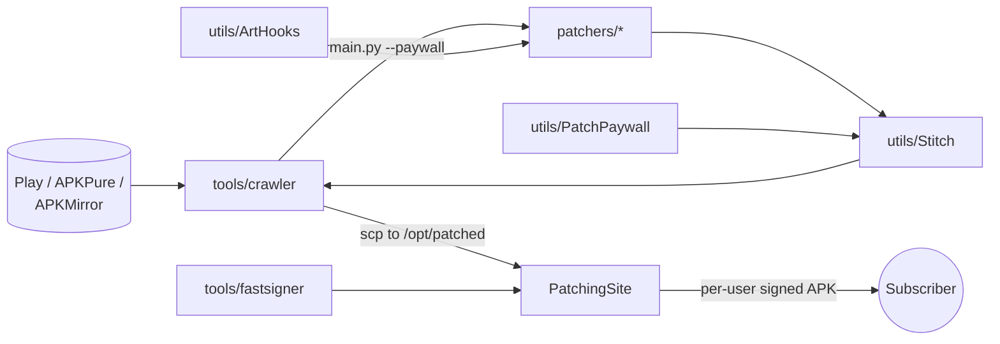

# PatchingMonorepo

One home for everything involved in patching Android apps: the libraries that inject code into
an APK, the patchers built on them, the tools that fetch and sign builds, and the site that
delivers patched apps to subscribers.

Every directory below is a **git submodule** pointing at its own repository. This repo pins them
together at versions known to work with each other.

## Layout

```
PatchingMonorepo/
├── patchers/                      one patcher per app
│   ├── WhatsAppPatcher/           WhatsApp: revoked messages kept, view-once saving, group stats, ...
│   ├── MoovitPatcher/             Moovit: no ads, live location
│   ├── MakoPatcher/               Mako (12+): no ads
│   ├── ReshetPatcher/             Reshet (13+): no ads in VOD or live
│   ├── OkCupidPatcher/            OkCupid: premium unlocked, unblurred "Interested in You"
│   └── genericPatcher/            Any app: ads removed, ads only (powers the store's "Patch an app from your phone")
│
├── utils/                         libraries the patchers are built on
│   ├── Stitch/                    Python: injects a Gradle module into an APK / APKM / XAPK
│   ├── ArtHooks/                  Android: minimal ART method-hooking library (AAR)
│   └── PatchPaywall/              Android: subscription check injected into every served build
│
├── tools/
│   ├── crawler/                   downloads new app versions, runs their patchers, uploads them
│   └── fastsigner/                Rust: fast APK v2/v3 signer, drop-in for zipalign + apksigner
│
├── skills/
│   └── Android-Patching-Skill/    Claude Code skill that reverses an APK and scaffolds a new patcher
│
└── PatchingSite/                  subscription site: FastAPI + React + Android store client
```

## How the pieces fit together



1. **`tools/crawler`** watches each app on Google Play, APKPure and APKMirror, and downloads any
   version newer than what is already in `/opt/patched/<package>/<version>/`.
2. For each new build it runs the app's **patcher** (`patchers/<Name>/main.py`), passing it the
   **PatchPaywall** module.
3. The patcher uses **Stitch** to inject its own `smali_generator` Gradle module (hooks written
   with **ArtHooks**) plus the paywall into the APK. App-specific obfuscated names are found at
   patch time by regex signatures in `artifactory_generator/`, so patchers keep working across
   app updates.
4. The crawler uploads the unsigned result to the server.
5. **PatchingSite** serves it. Each download is re-signed on demand with **fastsigner** (bundled
   inside Stitch), with a per-user token written into `assets/paywall.json`.
6. When the patched app starts, **PatchPaywall** sends that token to
   `/api/subscription/is_device_allowed` and exits if the server refuses it.

**`skills/Android-Patching-Skill`** sits outside this pipeline. It is how new patchers get
started: give it an APK and the behaviour to change, and it finds the method responsible and
generates a patcher with the same `main.py` / `artifactory_generator/` / `smali_generator/`
layout as the existing ones.

## Components

| Path | Language | Description |
|---|---|---|
| [`patchers/WhatsAppPatcher`](https://github.com/Schwartzblat/WhatsAppPatcher) | Python + Java | Signature-verifier bypass, revoked messages kept, view-once saving, read receipts per chat, group statistics, Drive backups, and an in-app settings screen |
| [`patchers/MoovitPatcher`](https://github.com/Schwartzblat/MoovitPatcher) | Python + Java | No ads, live location (needs a Google API key) |
| [`patchers/MakoPatcher`](https://github.com/Schwartzblat/MakoPatcher) | Python + Java | No ads for the Mako / 12+ streaming app |
| [`patchers/ReshetPatcher`](https://github.com/Schwartzblat/ReshetPatcher) | Python + Java | No ads for the Reshet / 13+ streaming app: VOD and live video ads (including the server-side G-Mana ads in the live stream), GMA interstitial and banner ads, and web ads in its WebViews |
| [`patchers/OkCupidPatcher`](https://github.com/Schwartzblat/OkCupidPatcher) | Python + Java | Premium unlocked, unblurred photos and real names on likes, background identity sweep |
| [`patchers/genericPatcher`](https://github.com/Schwartzblat/GenericPatcher) | Python + Java | Removes ads from any app, ads only. Its bundle powers the store's "Patch an app from your phone" |
| [`utils/Stitch`](https://github.com/Schwartzblat/Stitch) | Python | Decodes the APK, builds a Gradle module, merges its smali, resources and manifest into the app, and signs the result. Published on PyPI as `stitch` |
| [`utils/ArtHooks`](https://github.com/Schwartzblat/ArtHooks) | Java + C++ | Redirects Java methods by overwriting their `ArtMethod` entry points. Works without root or Xposed. Distributed via JitPack |
| [`utils/PatchPaywall`](https://github.com/Schwartzblat/PatchPaywall) | Java | A `ContentProvider` that checks the subscription before the app's own code runs |
| [`tools/crawler`](https://github.com/Schwartzblat/ApkCrawler) | Python | Downloads, patches and uploads new app versions (`run_crawler.sh`) |
| [`tools/fastsigner`](https://github.com/Schwartzblat/fastsigner) | Rust | Implements APK Signature Scheme v2/v3. About 100× faster than `apksigner`, with byte-identical output for RSA keys |
| [`skills/Android-Patching-Skill`](https://github.com/Schwartzblat/Android-Patching-Skill) | Markdown + scripts | Claude Code skill (`/android_patching`) that takes an APK to a working patcher |
| [`PatchingSite`](https://github.com/Schwartzblat/PatchingSite) | Python + JS + Kotlin | FastAPI + SQLite backend, React 19 + Vite frontend, Stripe billing, Kotlin/Compose Android store |

Each component has its own README covering requirements, setup and usage.

## Getting started

Clone with all submodules, including the nested `smali_generator/library` submodules in the
patchers:

```bash
git clone --recurse-submodules git@github.com:Schwartzblat/PatchingMonorepo.git
cd PatchingMonorepo
```

If you already cloned without them:

```bash
git submodule update --init --recursive
```

Common requirements across the projects are **Python 3.11+**, **JDK 17+** and an
**Android SDK** (`$ANDROID_HOME`). The Rust toolchain is only needed to build `fastsigner`
yourself, and Node 20+ only for the PatchingSite frontend.

Patching a single app by hand, for example Moovit:

```bash
cd patchers/MoovitPatcher
pip install -r requirements.txt
python main.py -p ./moovit.apkm -g YOUR_GOOGLE_API_KEY
```

## Working with submodules

Each submodule is a separate repository, so changes are committed in two steps: first in the
submodule, then here to record the new pin.

```bash
# 1. commit and push inside the submodule
cd utils/Stitch
git checkout main && git pull
# ...edit, commit...
git push

# 2. record the new commit in the monorepo
cd ../..
git add utils/Stitch
git commit -m "Bump Stitch"
```

Some useful commands:

```bash
git submodule status                         # pinned commit of every submodule
git submodule update --remote --merge        # move every submodule to its branch tip
git submodule foreach 'git status --short'   # uncommitted work across all of them
```

## Disclaimer

For educational and research purposes only. The patchers modify third-party apps. You are
responsible for complying with those apps' terms of service and with the law where you live.
